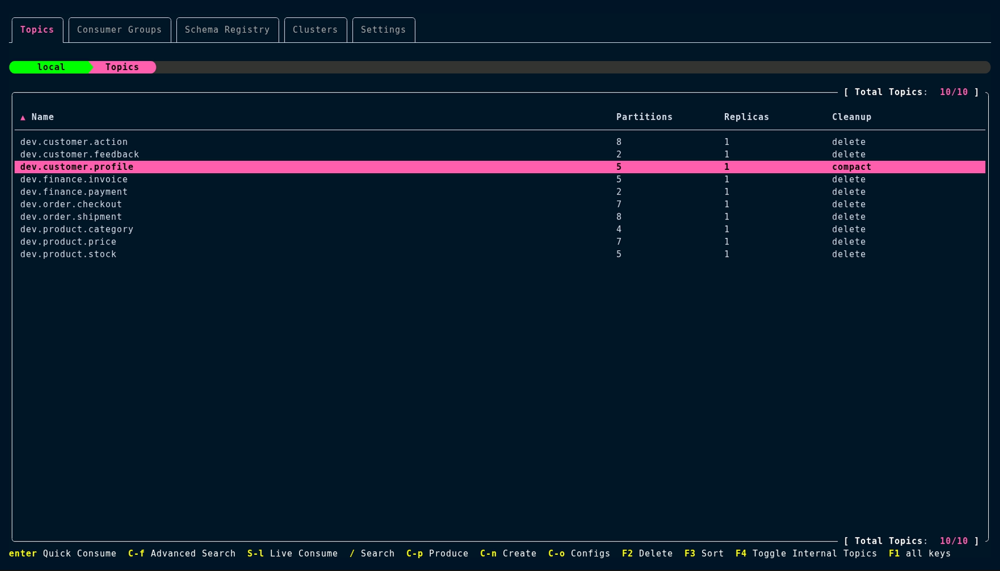
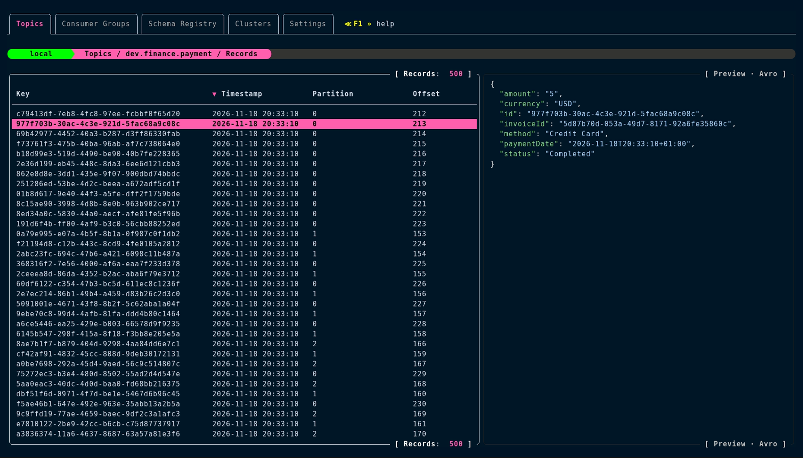
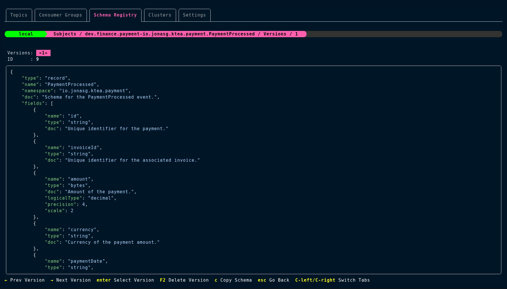
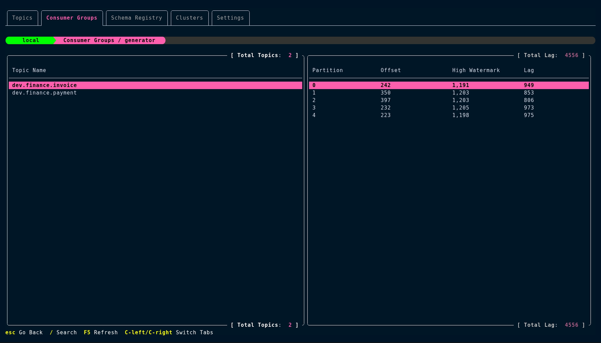

[](https://github.com/PSanetra/kfee/releases)
[](https://github.com/PSanetra/kfee/actions)
[](https://raw.githack.com/wiki/PSanetra/kfee/coverage.html)

# ☕ kfee - kafka terminal client

kfee is a tool designed to simplify and accelerate interactions with Kafka clusters.
It is a fork of [ktea](https://github.com/jonas-grgt/ktea) by Jonas Geiregat, released separately starting with
version 1.0.0. On top of ktea it adds:

- **Protobuf decoding** of raw protobuf records with your `.proto` files or without schema, configured in the TUI per
  topic and optionally selecting the message type by a header, see [Protobuf decoding](#protobuf-decoding)
- **Full topic search**, also in header values, most recent matches first
- **Record preview** next to the records in wide terminals, `c` copies the previewed record
- **`kfee confluent`** to add a Confluent Cloud cluster using the Confluent CLI, see [Confluent Cloud](#confluent-cloud)
- **`connections.yaml`**, keeping the connection settings and credentials of clusters separate and readable by your
  user only, see [Configuration](#configuration)

If you're a **k9s** user, you'll love **kfee**!

**List Topics**


**Browse Records with Preview**


**View AVRO Schema**


**View Consumer Lag**


## Installation

Binaries for Linux, macOS and Windows as well as `deb`, `rpm`, `apk` and Arch Linux packages are available on the
[release page](https://github.com/PSanetra/kfee/releases).

To build kfee yourself with [Go](https://go.dev/dl/):

```sh
git clone https://github.com/PSanetra/kfee.git
cd kfee
CGO_ENABLED=0 go build -o kfee ./cmd/kfee
```

### Nix

The repository is a flake. Run kfee without installing it with `nix run github:PSanetra/kfee`, or add it to your
NixOS configuration:

```nix
# flake.nix
{
  inputs.kfee.url = "github:PSanetra/kfee";

  outputs = { nixpkgs, kfee, ... }: {
    nixosConfigurations.my-host = nixpkgs.lib.nixosSystem {
      modules = [
        kfee.nixosModules.default
        { programs.kfee.enable = true; }
      ];
    };
  };
}
```

`kfee.homeManagerModules.default` provides the same `programs.kfee.enable` option for Home Manager, and
`kfee.overlays.default` adds `pkgs.kfee`. The package includes `protoc` for [Protobuf decoding](#protobuf-decoding),
a `protoc` on your `PATH` takes precedence. Use `inputs.kfee.url = "github:PSanetra/kfee/v1.0.0"` to pin a release.

kfee uses its own configuration directory, so it can be installed next to ktea. To take over a ktea configuration,
copy `~/.config/ktea` to `~/.config/kfee` and move the connection settings to `connections.yaml`,
see [Configuration](#configuration).

## Usage

### Navigation

All tables can be navigated using vi like bindings:
- up: `j`
- down: `k`
- page down: `d`
- page up: `u`

### Configuration

The configuration is stored in two files in `~/.config/kfee/`
(`$XDG_CONFIG_HOME/kfee/` when `XDG_CONFIG_HOME` is set, on macOS too; all `~/.config/kfee` paths below follow it):

- `config.yaml` holds the settings not related to connecting to clusters: theme, fonts and per cluster its name,
  color, whether it is active and its protobuf decoders.
- `connections.yaml` holds the connection settings of the clusters: servers, credentials, TLS, Schema Registry and
  Kafka Connect. It is only readable by your user (`0600`). If you use AI coding agents, consider denying them
  access to this file, e.g. with a `Read(~/.config/kfee/connections.yaml)` deny rule in Claude Code.

All cluster configurations can be managed through the TUI even the initial one.

Example configuration files:

```yaml
# config.yaml
plainFonts: true # when nerd-fonts are not available, set to true
clusters:
    - name: local
      color: '#FF0000'
      active: true
```

```yaml
# connections.yaml
clusters:
    local:
        servers:
            - localhost:9093
        sasl:
            authMethod: NONE
        tls:
            enable: true
            skipVerify: false
            caCertPath: "docker/cert/ca.crt"
        schemaRegistry:
            url: http://localhost:8081
            username: "user"
            password: "secret"
        kafkaConnectClusters:
            - name: PRD
              url: http://localhost:8083
              username: "admin"
              password: "secret"
```

Clusters only present in `connections.yaml` are added as well.
Connection settings in `config.yaml` (as written by ktea) are refused at startup, move them to `connections.yaml`.

### Protobuf decoding

Records serialized as raw protobuf (without schema registry framing) can be decoded using your `.proto` files.
This requires [`protoc`](https://protobuf.dev/installation/) to be installed.

1. Open a record of the topic and press `p`.
2. Browse to the directory containing the `.proto` files and press `ctrl+s`. Every directory shows how many
   `.proto` files it contains; `→`/`enter` opens a directory, `←` goes up, typing filters and directories used
   for other topics are listed first (★). All `.proto` files in the chosen directory and its subdirectories
   are compiled with `protoc`, the directory is used as import path.
3. Choose the message type of the record (press `/` to filter).
4. Optionally choose a header of the record as discriminator and adjust its value regex,
   the message type is then only used for records whose header matches.
   Choose *None* to use the message type for all other records of the topic.

Repeat these steps for every message type of the topic. Records are decoded to JSON, so searching works on the decoded values.
Pressing `p` on a topic with a decoder also allows removing it.

Without `.proto` files, choose *Without schema* in the first step (no `protoc` needed). Records are then decoded like
`protoc --decode_raw`: keys are field numbers and the types are guessed from the wire format, so varints are shown as
integers (bools, enums and `sint` look the same), fixed32/fixed64 as unsigned integers and length-delimited fields
as nested message, string or hex bytes. Such rules are stored as `raw: true` and can use a discriminator header too.

The decoders are stored per cluster in `config.yaml` and can be edited by hand as well (restart kfee afterwards):

```yaml
clusters:
    - name: local
      protobuf:
          protoc: protoc                 # optional, defaults to protoc from the PATH
          topics:
              - topic: orders
                protoDir: ~/src/protos
                rules:                   # the first matching rule wins
                    - messageType: acme.orders.v1.OrderCancelled
                      header: type
                      valueRegex: ^OrderCancelled$
                    - messageType: acme.orders.v1.OrderCreated   # no header: used for all other records
```

### Debug logging

Debug logs are written when `kfee` is started with `--debug`:

```sh
kfee --debug                 # writes ./debug.log
kfee --debug=/tmp/kfee       # writes /tmp/kfee/debug.log (when /tmp/kfee is a directory)
kfee --debug=/tmp/kfee.log   # writes /tmp/kfee.log
```

The path must be attached with `=`; `--debug /path` is not supported.

### Themes

kfee comes with several color themes, and you can write your own.
Choose one with the `theme` key in `~/.config/kfee/config.yaml`:

```yaml
theme: desert
```

Or open the **Settings** tab, select a theme and press `enter`: it is applied right away and saved to `config.yaml`.
Themes you add to the themes folder show up there the next time you open the tab.
If you edit `config.yaml` by hand, restart kfee to pick up the change.

#### Built-in themes

| Theme        | Description                                                                           |
|--------------|---------------------------------------------------------------------------------------|
| `default`    | The original pink and indigo colors of ktea. Used when `theme` is not set.            |
| `dracula`    | The [Dracula](https://draculatheme.com) palette, with Alucard on light terminals.     |
| `catppuccin` | The [Catppuccin](https://catppuccin.com/palette/) palette: Mocha when dark, Latte when light. Paints the flavor's background. |
| `catppuccin-latte`, `catppuccin-frappe`, `catppuccin-macchiato`, `catppuccin-mocha` | One Catppuccin flavor, always, whatever your terminal's background. Paints the flavor's background. |
| `desert`     | Muted sand gold and sage green. Paints the whole terminal dark brown when dark.       |
| `tokyonight` | [Tokyo Night](https://github.com/folke/tokyonight.nvim): Night when dark, Day when light. |
| `tokyonight-night`, `tokyonight-storm`, `tokyonight-moon`, `tokyonight-day` | One Tokyo Night style, always. |
| `gruvbox`    | [Gruvbox](https://github.com/morhetz/gruvbox): dark or light, following the terminal. |
| `gruvbox-dark`, `gruvbox-light` | One Gruvbox mode, always. |
| `nord`       | [Nord](https://www.nordtheme.com), dark only. |
| `rose-pine`  | [Rosé Pine](https://rosepinetheme.com/palette/): Main when dark, Dawn when light. |
| `rose-pine-main`, `rose-pine-moon`, `rose-pine-dawn` | One Rosé Pine variant, always. |
| `solarized`  | [Solarized](https://ethanschoonover.com/solarized/): dark or light, following the terminal. |
| `solarized-dark`, `solarized-light` | One Solarized mode, always. |
| `onedark`    | Atom's [One Dark](https://github.com/atom/one-dark-syntax), dark only. |

All themes except `default`, `dracula` and `desert` paint their own background, and they highlight
record payloads with the matching syntax style.

Most themes have a dark and a light variant.
When kfee starts, it asks your terminal whether its background is dark or light and uses the matching variant.
Themes named after one variant, such as `catppuccin-mocha` or `gruvbox-light`, always use that variant, and so do `nord` and `onedark`.

Themes that paint the background also set the default text color, and kfee restores your terminal's own colors when you switch to another theme or quit.

#### Creating your own theme

1. Create the folder `~/.config/kfee/themes/`.
2. Add a file `<name>.yaml` to it, for example `~/.config/kfee/themes/ocean.yaml`.
3. Set `theme: ocean` in `config.yaml` (the file name without `.yaml`).
4. Start kfee.

A custom theme starts from a built-in theme (its `base`) and changes only the colors you list.
A small file is enough to tweak an existing theme:

```yaml
# ~/.config/kfee/themes/my-dracula.yaml
base: dracula
dark:
  primary: "#50fa7b"
```

The file has these keys. All of them are optional:

| Key      | Meaning                                                                                                                  |
|----------|--------------------------------------------------------------------------------------------------------------------------|
| `base`   | Built-in theme to start from. Defaults to `default`.                                                                     |
| `dark`   | Colors used on a dark terminal background.                                                                               |
| `light`  | Colors used on a light terminal background. When missing, the `dark` colors are used for light terminals too.           |
| `syntax` | [Chroma style](https://xyproto.github.io/splash/docs/) used to highlight record payloads, e.g. `monokai` or `nord`.       |

Colors are hex values (`"#ff79c6"`) or ANSI color numbers 0-255 (`"212"`).
Always put colors in quotes, because YAML treats an unquoted `#` as the start of a comment.

These colors can be set under `dark` and `light`:

| Color          | Used for                                                             |
|----------------|----------------------------------------------------------------------|
| `primary`      | active tab, table selection, highlighted counts, buttons             |
| `primaryMuted` | inactive counts and selected-but-unfocused chips                     |
| `accent`       | prompts and form titles                                              |
| `highlight`    | keys in the help screen                                              |
| `text`         | regular text                                                         |
| `textMuted`    | secondary text and inactive border titles                            |
| `textFaint`    | inactive tabs and placeholders                                       |
| `onPrimary`    | text drawn on a `primary` background                                 |
| `surface`      | status bar background                                                |
| `surfaceAlt`   | inactive chips and buttons                                           |
| `borderFocus`  | border of the focused element                                        |
| `borderBlur`   | border of unfocused elements                                         |
| `active`       | active tab inside a bordered box                                     |
| `success`      | success messages                                                     |
| `error`        | error messages                                                       |
| `background`   | paints the whole terminal background while kfee runs and makes `text` the default text color (leave it out to keep your terminal's colors) |

A complete theme that sets every color:

```yaml
# ~/.config/kfee/themes/ocean.yaml
syntax: nord
dark:
  primary: "#5fb3d9"
  primaryMuted: "#3d7a99"
  accent: "#7fd1b9"
  highlight: "#e6c07b"
  text: "#d8e3ea"
  textMuted: "#9fb2bf"
  textFaint: "#6b7f8c"
  onPrimary: "#0f1a21"
  surface: "#1d2b35"
  surfaceAlt: "#26394a"
  borderFocus: "#7fd1b9"
  borderBlur: "#26394a"
  active: "#5fb3d9"
  success: "#7fd1b9"
  error: "#e06c75"
  background: "#0f1a21"
light:
  primary: "#1f6f99"
  accent: "#2f8f74"
  text: "#14232d"
  onPrimary: "#ffffff"
```

The `light` section above only lists four colors. That is fine: colors you leave out come from `base`,
not from `dark`, so here they are taken from the `default` theme's light variant.

If a theme file has a mistake, such as an unknown color name, an invalid color or an unknown base,
kfee does not start and prints which field is wrong, for example:

```
kfee: theme "ocean": unknown color dark.primry
```

Cluster colors are set per cluster (see above) and do not change with the theme.

### Cluster Management

Multiple clusters can be added.
Upon startup when no cluster is configured, you will be prompted
to add one.

#### Confluent Cloud

With the [Confluent CLI](https://docs.confluent.io/confluent-cli/current/install.html) installed, run

```sh
kfee confluent
```

to add a Confluent Cloud cluster. The wizard lets you choose the environment and Kafka cluster
(offering to run `confluent login` when needed), creates an API key described as `kfee <date time>`
and optionally a second one for the environment's Schema Registry, and saves the cluster (its connection settings to `connections.yaml`).

#### TLS support

- TLS can be enabled by setting `tls.enabled` to true in the cluster configuration.
- `tls.skipVerify` can be set to true to skip TLS certificate verification (not recommended for production).
- `tls.caCertPath` can be set to the path of the CA certificate to use

#### Supported Auth Methods

- None (no authentication)
- SASL 
    - Plaintext

## Features

- *Multi-Cluster Support*: Seamlessly connect to multiple Kafka clusters and switch between them with ease.
- *Topic Management*: List, create, delete, and modify topics, including partition and offset details.
- *Record Consumption*: Consume records in text, JSON, **Avro** and **Protobuf** formats, with powerful search capabilities.
- *Consumer Group Insights*: Monitor consumer groups, view their members, and track offsets.
- *Schema Registry Integration*: Browse, view, and register schemas effortlessly.
- *Kafka Connect Integration*: Browse, view, and Update clusters.

## Todo

- Add more authentication methods
- Add support for more message formats such as schema registry protobuf.
- Add ACL management.
- File based import/export of topics.
- Add ability to delete specific schema versions.
- Add consumption templating support.
- Many more, just file an issue requesting a feature!

## Development

### Dev cluster setup

A docker-compose setup is provided to quickly spin up a local Kafka cluster with pre-created topics, consumer groups,
commited offsets etc ...

`docker/docker-compose.yml` contains a cluster, schema-registry and kafka-connect setup.
`docker/docker-compose-ssl.yml` contains a ssl enabled cluster only
`docker/docker-compose-scram.yml` contains a Redpanda cluster with SASL/SCRAM

The `Makefile` wraps these, run `make` to list all goals:

- `make up`, `make up-ssl` or `make up-scram` starts a cluster (only one runs at a time, they all use port 9092)
- `make seed` creates topics, consumer groups and offsets on the default cluster
- `make down` stops all clusters, `make clean` also deletes their data

### Generate data

After the local cluster is up and running, you can generate some data to work with, 
using `make generate` (`go run ./cmd/generate`).

### Run `kfee`

Use `make run` (`go run -tags dev ./cmd/kfee`) to run `kfee` from the root of the repository,
or `make run-debug` to also write a `debug.log`
(use `go run -tags dev ./cmd/kfee --debug=PATH` to write it somewhere else).

> Note: running the tui with dev build tag will simulate an artificial slow network by sleeping for 2 seconds when doing network IO. This way the loaders and spinners can be visually asserted.
> 

### Screenshots

The screenshots above are generated, see [docs/screenshots](docs/screenshots/README.md).

### Run tests

Because of interfering testcontainers kafka brokers the tests, for now, can't be run in parallel.
This will be fixed in the future.

```sh
go test -count=1 ./...  -p 1
```
